  
  
  

## About me

I'm **Ahmed Farahat**, a computer engineer in **Dubai**. Since my first internship I've been doing the same thing in different places: finding work that people do by hand and building the software that does it for them. Lately that software has AI in it.

I work on both sides of a product. I write the brief, then I write the code.

## What I'm working on

| | What I'm doing | Status |
|---|---|---|
| **Samsung Gulf Electronics** | Two roles at once: product management for home appliances, and AI engineering for the tools our stores use |  |
| **[aisle-guard](https://github.com/ahmedshxrif/aisle-guard)** | Guardrails that stop an AI shopping assistant from quoting prices, naming competitors or inventing specs |  |
| **[promolift](https://github.com/ahmedshxrif/promolift)** | Measuring price elasticity to find where a discount pays for itself |  |

## Where I've been

| | Role |
|---|---|
| **Henkel** | Regional Purchasing Intern |
| **Schneider Electric** | Global Supply Chain Intern. Automated three recurring reports and cut the manual work by 70% |
| **TriForce Systems** | Digital Transformation Intern. Built four automation systems and helped launch three process automations |
| **American University of Sharjah** | BSc, Computer Engineering. Merit scholarship, Dean's List |

## Highlights

- **Shipped an AI sales coaching product to production**, with 429 automated tests behind it
- **Led a team of four** building TRACE, a forensic AI tool designed with Dubai Police as the end user, with an injury model above 90% accuracy
- **Built a voice shopping assistant** that starts answering in about 2.5 seconds and checks every reply before it's spoken
- **Samsung Gulf Electronics Graduate Program**, class of 2026

## The stack

  

Plus LLM APIs (Anthropic and OpenAI), retrieval, voice and vision models, Power BI and Excel.

## Featured projects

| Project | What it does | Release |
|---|---|---|
| **[aisle-guard](https://github.com/ahmedshxrif/aisle-guard)** TypeScript · AI guardrails · CLI | Checks every reply an AI shopping assistant writes before a customer hears it. Fails closed: anything it can't verify against the spec sheet is blocked. 38 tests and a 44-case evaluation set. |   |
| **[promolift](https://github.com/ahmedshxrif/promolift)** Python · Pricing · CLI | Measures how sensitive each product is to price, finds the discount where profit peaks, and plans a promo budget. No dependencies. |   |
| **[capo](https://github.com/ahmedshxrif/capo)** Go · Music · CLI | Transposes chord sheets from the terminal and keeps every chord above the right word. One small binary. |   |
| **[leaflet-price-extractor](https://github.com/ahmedshxrif/leaflet-price-extractor)** Python · OCR · Data | Reads retailers' promotional leaflets and turns every offer into a row of data: brand, model, old price, new price. | |
| **[Portfolio](https://ahmedshxrif.github.io)** JavaScript · No framework | My site, with a phone you can pick up that runs nine small working copies of things I've built, including an arcade game. | [live](https://ahmedshxrif.github.io) |

## Get in touch

Email me at **asheriffarahat@gmail.com**. I speak English and Arabic.
